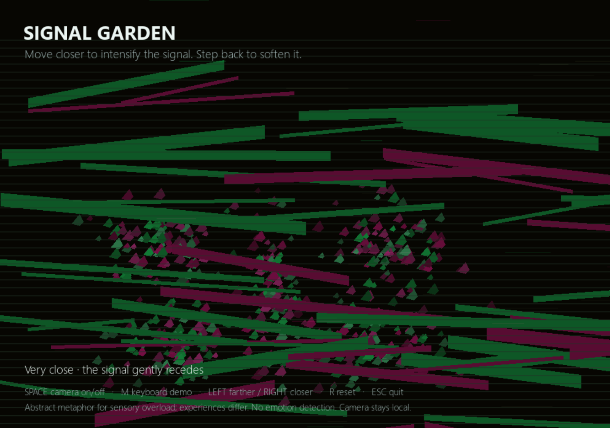

# Signal Garden

Signal Garden is a small, camera-based interactive artwork about how a visual signal changes with distance. It is intended as a low-pressure, user-controlled sensory interaction, with autistic children as a possible audience. It does not represent every autistic person's experience, and it is not a medical, therapeutic, diagnostic, or emotion-recognition tool.
The neon, fragmented visuals are an abstract metaphor for sensory overload, which some autistic people may experience; they do not represent every autistic person’s experience.

## Screenshot



## The interaction

Press SPACE to turn on the webcam. Moving closer makes the signal brighter, larger, and more fragmented; stepping back softens it. The artwork uses a near-black background, neon pink and fluorescent green, broad paint-like streaks, sharp fragments, broken horizontal lines, and scanline texture. Even before a face is detected, a few very faint, fixed glitch marks remain on screen. These visual elements are an abstract metaphor for sensory overload, not a claim about what autism looks or feels like. If no face is detected, the main signal stays still while a few quiet glitch lines remain. At very close range the signal gradually recedes. The controls let the user stop or switch to a keyboard demonstration at any time.

A first user trial found that the face was sometimes hard to detect and the meaning of the original pale pattern was unclear. The participant also said the image was difficult to see. In response, this version uses stronger contrast and clearer movement instructions, and the face-area thresholds have been adjusted to make the response begin sooner. The new visual treatment still needs another trial to confirm that the change is clearer and comfortable to use. The quiet idle glitch marks are fixed in place; they do not flash or jump.

## Privacy and limits

OpenCV's built-in Haar cascade locates a face; the program uses its bounding-box area as a rough relative near/far cue. It does not inspect facial expression or infer emotion. This is not a distance measurement in centimetres, and camera angle, lighting, face position, or partial occlusion can affect detection. Camera frames are processed locally, never displayed, saved, or uploaded. The visual design is intentionally high contrast; it may not suit every viewer. Stop or switch to the keyboard demo if it feels uncomfortable.

## Run it

Install [uv](https://docs.astral.sh/uv/) if needed. From this project folder, run:

```text
uv run app.py
```

The script declares `opencv-python<5` and `pygame-ce`; `pygame-ce` provides the `pygame` import. The first run needs internet access to install dependencies. Allow camera access when prompted. Press SPACE to toggle the camera, M to enter keyboard demo, LEFT/RIGHT to adjust the simulated distance, R to reset the demo, and ESC to quit.
